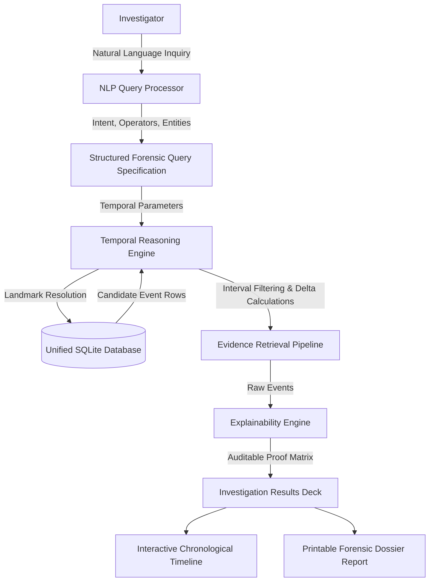

# FORENSIQ
### NLP-Based Digital Forensic Investigation and Temporal Query System

[](LICENSE)
[](https://www.python.org/)
[](https://fastapi.tiangolo.com/)
[](https://reactjs.org/)
[](https://tailwindcss.com/)
[](https://www.sqlite.org/)

---

## Overview

**FORENSIQ** is a digital forensic investigation intelligence platform that enables cybersecurity investigators, incident responders, and forensic auditors to query complex, heterogeneous forensic event data using plain English natural language.

Traditional digital forensics forces analysts to write complex SQL statements, master disparate log schemas, and calculate time deltas manually. FORENSIQ eliminates this barrier by transforming natural language questions into deterministic, structured forensic queries, dynamically discovering landmark reference events, applying temporal interval filtering, and providing auditable, step-by-step explainability for all retrieved evidence.

---

## Core Innovation

```
Natural Language
      ↓
NLP Interpretation
      ↓
Structured Forensic Query
      ↓
Temporal Landmark Resolution
      ↓
Forensic Event Search (SQLite)
      ↓
Temporal Interval Filtering
      ↓
Evidence Retrieval
      ↓
Explainable Reasoning
      ↓
Chronological Timeline
```

---

## Key Features

- **Natural-Language Forensic Investigation:** Ask investigator questions in plain English (e.g., *"Show me failed login attempts before the successful login"*).
- **Deterministic NLP Query Interpretation:** Extracts intent, target event types, actions, statuses, directional temporal operators (`BEFORE`, `AFTER`, `WITHIN`, `BETWEEN`), landmark reference events, and duration windows without external LLM dependencies.
- **Structured Forensic Query Specification:** Converts unstructured investigator queries into a transparent JSON query specification.
- **Dynamic Temporal Reasoning Engine:** Automatically locates landmark reference events (e.g., $T_{ref}$ of a successful login or USB insertion) and computes relative temporal bounds and deltas.
- **Heterogeneous Forensic Event Sources:** Normalized unified schema covering **Authentication**, **File System**, **USB Removable Media**, and **System/Process** telemetry.
- **Live Authentication Forensics:** Dynamic account setup and live verification. Wrong passwords automatically record real `FAILED_LOGIN` events; correct passwords record `SUCCESSFUL_LOGIN` events into SQLite.
- **USB & File Exfiltration Sandbox:** Interactive control deck to simulate peripheral insertion, file access, data transfer, and removal without accessing personal client files.
- **Explainable AI (XAI) Verification:** Step-by-step audit proof verifying event type match, action match, status match, temporal precedence, and provenance for every evidence item.
- **Interactive Chronological Timeline:** Color-coded timeline view reconstructing sequence of events with deltas relative to landmark anchors.
- **Unified Evidence Explorer:** Multi-criteria search and filter deck with CSV export capability.
- **Forensic Case Dossiers:** Organize investigations into trackable case files with investigator assignments.
- **Confidential Investigation Reports:** Generates professional, objective forensic incident reports ready to print or copy to Markdown.

---

## System Architecture



### Repository Structure

```
FORENSIQ/
├── frontend/                   # React 18 + TypeScript + Vite + Tailwind CSS
│   ├── src/
│   │   ├── api/                # Typed REST API client (Agent, Email, Sim, Evidence)
│   │   ├── components/         # Sidebar, Navbar (Host Agent Pill), EventDetailModal, ReportModal
│   │   ├── pages/              # Dashboard, Investigate, Timeline, Evidence, USB & Exfil, Cases, Explainability, Login
│   │   ├── types/              # Comprehensive TypeScript interfaces
│   │   ├── App.tsx             # Root layout and tab navigation
│   │   ├── main.tsx            # Application entrypoint
│   │   └── index.css           # Custom dark theme and glow utilities
│   ├── package.json
│   ├── tsconfig.json
│   ├── vite.config.ts
│   └── tailwind.config.js
│
├── backend/                    # Python 3.12 + FastAPI + SQLite Engine
│   ├── app/
│   │   ├── agent/              # Windows Host Monitoring Agent (kernel32 + WMI + Watchdog)
│   │   │   └── host_agent.py
│   │   ├── api/                # auth, investigate, events, simulate, simulate_email, agent, cases, dashboard
│   │   ├── database/           # SQLite schema, migration, seed, and 15k dataset generator
│   │   │   ├── db.py
│   │   │   ├── seed_data.py
│   │   │   └── generate_dataset.py # Deterministic 15,000+ synthetic forensic generator
│   │   ├── explainability/     # Step-by-step audit justification generator
│   │   ├── forensic/           # Dynamic SQL parameterized query builder
│   │   ├── models/             # Pydantic schemas and serialization models
│   │   ├── nlp/                # Deterministic rule & keyword NLP parser (expanded vocabulary)
│   │   ├── temporal/           # Reference event anchor & temporal window engine
│   │   ├── config.py           # Application configuration
│   │   └── main.py             # FastAPI entrypoint and lifespan hooks
│   ├── run_agent.py            # Standalone launcher for Windows host monitoring agent
│   ├── requirements.txt
│   └── test_extended_pipeline.py # Comprehensive test suite for all forensic pipelines
│
├── data/
│   ├── sample/
│   │   └── lanl_cyber_sample.json  # Normalized subset of LANL Cyber Security Dataset
│   └── README.md
│
├── docs/
│   ├── architecture.md         # Detailed architectural specification
│   ├── dataset.md              # 15,000+ synthetic dataset schema and attack sequences
│   ├── demo.md                 # Complete evaluator and professor demo walkthrough
│   └── project-overview.md     # Industrial & academic motivation
│
├── run_all.bat                 # Master launcher (opens Edge to frontend & backend docs)
├── run_backend.bat             # Backend launcher
├── run_frontend.bat            # Frontend launcher
├── screenshots/
│   └── README.md               # Visual artifact specifications
│
├── .env.example                # Safe environment variable template
├── .gitignore                  # GitHub safe gitignore configuration
├── LICENSE                     # MIT Open Source License
├── package.json                # Root proxy scripts
└── README.md                   # Primary documentation
```

---

## Technology Stack

- **Frontend:** React 18, TypeScript, Tailwind CSS, Lucide Icons, Vite
- **Backend:** Python 3.12+, FastAPI, Uvicorn, Pydantic v2, Python-Dateutil
- **Storage:** SQLite 3 (Unified Relational Event Store)
- **NLP Engine:** Deterministic rule, regex, and keyword tokenization engine
- **Telemetry Sources:** Live Authentication Layer, Controlled Peripheral Simulator, LANL Public Cyber Security Telemetry

---

## Installation & Setup

### Prerequisites
- Python 3.10+ (Verified on Python 3.12)
- Node.js v18+ (Verified on Node.js v22)
- Git

### 1. Clone Repository
```bash
git clone https://github.com/your-username/FORENSIQ.git
cd FORENSIQ
```

### 2. Backend Setup
```bash
cd backend
python -m pip install -r requirements.txt
```

### 3. Frontend Setup
```bash
cd ../frontend
npm install
```

---

## Running the Application

### Option A: 1-Click Launch (Windows)
Double-click `run_all.bat` in the project root. This opens both backend and frontend servers in separate windows.

### Option B: Manual Commands

**Terminal 1 — Backend:**
```bash
cd backend
python -m uvicorn app.main:app --host 127.0.0.1 --port 8000 --reload
```
- API Documentation / Swagger: `http://127.0.0.1:8000/docs`
- Health Check: `http://127.0.0.1:8000/api/health`

**Terminal 2 — Frontend:**
```bash
cd frontend
npm run dev
```
- Web Application: `http://localhost:5173`

---

## Demo Account & Setup Instructions

The application ships with a pre-configured demo account and allows creating custom investigator or suspect accounts on the fly:

- **Pre-configured Demo User:** `Gopal`
- **Pre-configured Password:** `password123`
- **Machine Hostname:** `FORENSIQ-PC`

You can also create any custom user directly in the **"Live Auth Demo"** tab by expanding **"Configure Account"**.

---

## Exact Live Demonstration Steps

### DEMO 1: Authentication Anomaly & Dynamic Temporal Filtering
1. Open `http://localhost:5173` and click **"Live Auth Demo"** in the sidebar.
2. Confirm the username is **Gopal**.
3. Click **[ Simulate Wrong Password (Record FAILED) ]** 2 to 3 times.
   - *Result:* FastAPI checks password hash, returns HTTP 401, and automatically logs real `FAILED_LOGIN` events into SQLite with true UTC timestamps.
4. Click **[ Enter Correct Password (Authenticate) ]** with `password123`.
   - *Result:* FastAPI authenticates successfully, returns HTTP 200, and logs a real `SUCCESSFUL_LOGIN` event.
5. Click **"Investigate this Auth Sequence in FORENSIQ"** (or click the **Investigate** tab).
6. Click the sample prompt:
   ```text
   Show me failed login attempts before the successful login.
   ```
7. Click **[ INVESTIGATE ]**.
8. Inspect the 4 core sections:
   - **Query Interpretation:** Identifies intent as `Authentication Investigation`, relation as `BEFORE`, landmark as `successful_login`.
   - **Structured Forensic Query:** Formatted JSON query showing resolved SQLite landmark `EVT-AUTH-XXXX`.
   - **Evidence Results:** Displays the exact failed attempts from Step 3.
   - **Explainable Reasoning:** Checkmark verification matrix with relative negative time deltas (e.g. `-21s`, `-38s`).
9. Now run dynamic temporal filtering:
   ```text
   Show failed login attempts within 5 minutes before the successful login.
   ```
   - Notice how the temporal engine computes the window bounds `[T_ref - 5m, T_ref]` dynamically.

### DEMO 2: Removable Storage & USB Exfiltration
1. Open the **"USB Investigation"** tab in the sidebar.
2. Click **[ Execute Full 4-Step Incident Sequence (1-Click) ]**.
   - *Result:* Generates real SQLite records for `USB_CONNECTED` -> `FILE_ACCESS` (`Financial_Report.xlsx`) -> `FILE_COPY` -> `USB_REMOVED`.
3. In the inquiry box, click **[ Execute USB Temporal Query ]** or enter:
   ```text
   What files were copied to USB after it was connected?
   ```
4. *Result:* Correctly extracts `Financial_Report.xlsx`, proves destination `USB-001`, and verifies temporal sequence after device insertion.

### DEMO 3: Forensic Report Generation
1. In the **Investigate** tab, click **[ Generate Official Report ]**.
2. View the formal, confidential forensic assessment with provenance breakdown.
3. Click **Copy Report** (Markdown) or **Print / PDF** (formatted print layout).

---

## Supported Natural-Language Forensic Queries

FORENSIQ supports rich investigative phrasings:

1. **Authentication Inquiries:**
   - `"Show me failed login attempts before the successful login."`
   - `"Show failed login attempts within 5 minutes before the successful login."`
   - `"Show failed login attempts within 1 minute before the successful login."`
   - `"Show failed logins for user Gopal"`
   - `"Show me the complete authentication timeline."`
   - `"What happened after the successful login?"`
2. **Peripheral & Removable Media Inquiries:**
   - `"What files were copied to USB after it was connected?"`
   - `"Show USB connection events"`
   - `"Show files transferred to USB"`
   - `"Show all USB events"`
3. **File & System Inquiries:**
   - `"Show file access events"`
   - `"Show system events after login"`
   - `"What happened before the suspicious login?"`

---

## Where the Datasets are Stored

All data in FORENSIQ is stored locally in the **SQLite Database (`backend/forensiq.db`)**:
1. **Live Authentication Telemetry:** Ingested dynamically in real time from the login system.
2. **Simulated Forensic Source:** Populated on demand from the USB & File simulation deck.
3. **Public Dataset (LANL Sample):** Pre-seeded from `data/sample/lanl_cyber_sample.json`, which contains a normalized representative subset of authentic enterprise Kerberos tickets, logon events, and process executions from the **Los Alamos National Laboratory (LANL) Cyber Security Dataset**.

Every record is explicitly tagged with its origin label (`Live Authentication`, `Simulated Forensic Source`, `Public Dataset`) for forensic provenance.

---

## Security & GitHub Safety

- **No hardcoded secrets or credentials:** All passwords in the database use salted SHA-256 cryptographic hashes.
- **Git Hygiene:** Local databases (`*.db`, `*.sqlite`), virtual environments, and node modules are explicitly ignored in `.gitignore`.
- **Environment Template:** Safe `.env.example` provided with non-sensitive defaults.

---

## License

This project is licensed under the MIT License - see the [LICENSE](LICENSE) file for details.
