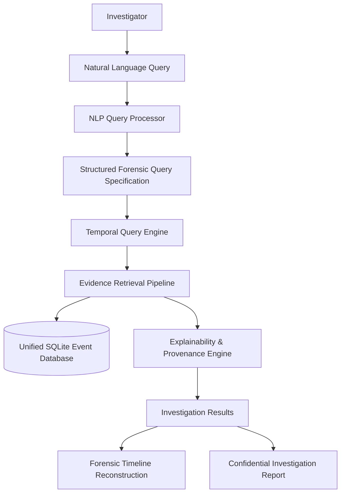

# FORENSIQ System Architecture

## Architectural Philosophy
Digital forensics typically requires investigators to possess deep SQL knowledge, construct intricate multi-table joins across heterogeneous operating system event logs, and manually calculate temporal deltas. **FORENSIQ** bridges this gap by introducing a deterministic natural-language-to-forensic-query pipeline coupled with temporal interval reasoning and explainable evidence verification.

## End-to-End Pipeline

## Core Subsystems

### 1. NLP Query Engine (`backend/app/nlp/parser.py`)
- **Deterministic Tokenization & Semantic Tagging:** Operates locally without external cloud dependencies or nondeterministic LLM hallucinations.
- **Entity Extraction:**
  - **Intent Classification:** Detects whether the query pertains to authentication anomalies (`authentication_investigation`), removable storage exfiltration (`usb_investigation`), file activity (`file_investigation`), or general system timeline reconstruction (`temporal_timeline`).
  - **Temporal Relation Extraction:** Identifies directional operators (`BEFORE`, `AFTER`, `WITHIN`, `BETWEEN`).
  - **Temporal Window Parser:** Extracts numeric duration and unit (e.g. `within 5 minutes` -> `300 seconds`).
  - **Landmark Reference Detection:** Identifies the anchor event against which temporal conditions are evaluated (e.g., `successful_login`, `usb_connected`).
  - **Target User Scope:** Extracts subject entity restrictions (e.g. `user Gopal`, `by admin`).

### 2. Temporal Reasoning Engine (`backend/app/temporal/engine.py`)
- **Reference Event Anchor Resolution:**
  - Queries SQLite for the definitive landmark event matching the reference criteria (e.g., latest `SUCCESSFUL_LOGIN` by the active user).
  - Retrieves reference timestamp $T_{ref}$.
- **Interval Bounds Calculation:**
  - **BEFORE Condition:** Range is $(-\infty, T_{ref}]$ (or $[T_{ref} - W, T_{ref}]$ if time window $W$ is specified).
  - **AFTER Condition:** Range is $[T_{ref}, +\infty)$ (or $[T_{ref}, T_{ref} + W]$ if time window $W$ is specified).
- **Time Delta Computation:** Computes precise signed millisecond and second deltas between each candidate event and the reference landmark.

### 3. Unified Forensic Data Store (`backend/app/database/db.py`)
Normalized relational schema stored in SQLite:

| Column | Type | Description |
|---|---|---|
| `event_id` | TEXT (PK) | Globally unique identifier (e.g., `EVT-AUTH-0012`) |
| `timestamp` | TEXT | ISO 8601 UTC timestamp with microsecond resolution |
| `event_type` | TEXT | Logical forensic family (`authentication`, `file`, `usb`, `system`, `network`) |
| `user` | TEXT | Subject user or system security principal |
| `machine` | TEXT | Target workstation or domain controller hostname |
| `source` | TEXT | Log emitter (e.g., `Application Login`, `USB Hub Driver`, `Public Dataset`) |
| `action` | TEXT | Standardized forensic action (`FAILED_LOGIN`, `USB_CONNECTED`, `FILE_COPY`) |
| `status` | TEXT | Normalized outcome (`SUCCESS`, `FAILED`, `INFO`, `WARNING`) |
| `device` | TEXT | Peripheral identifier (e.g. `USB-001 (SanDisk Cruzer)`) |
| `file` | TEXT | Target file artifact (e.g. `Financial_Report.xlsx`) |
| `metadata` | TEXT | Structured JSON payload with raw source attributes |
| `dataset_label` | TEXT | Origin classification (`Live Authentication`, `Simulated Forensic Source`, `Public Dataset`) |

### 4. Explainable AI & Reasoning Engine (`backend/app/explainability/explainer.py`)
Every retrieved record contains an auditable proof matrix verifying:
1. **Event Type Verification:** Confirms matched category.
2. **Action / Status Matching:** Validates exact state match.
3. **Temporal Constraint Verification:** Mathematically proves $T_{evt} < T_{ref}$ or $T_{evt} > T_{ref}$.
4. **Time Window Verification:** Proves $|T_{evt} - T_{ref}| \le W$.
5. **Asset Classification & Sensitivity:** Validates asset label against security bounds (`CONFIDENTIAL`, `RESTRICTED`).
6. **Recipient Boundary Verification:** Audits untrusted external domain transfer (`INTERNAL` vs. `EXTERNAL`).
7. **Integrity & Provenance:** Documents source emitter, host identifier, and dataset provenance.

### 5. Windows Host Monitoring Agent (`backend/app/agent/host_agent.py`)
- **Native Drive Polling:** Uses Win32 standard library APIs (`kernel32.GetLogicalDrives` and `kernel32.GetDriveTypeW`) to identify removable volume insertion and unmounting in sub-millisecond execution time.
- **Hardware Telemetry Resolution:** Correlates logical drive letters with physical disk descriptors via WMI (`Win32_DiskDrive` and `Win32_LogicalDisk`), extracting manufacturer, model, serial number, and categorizing device type (`USB_FLASH_DRIVE`, `EXTERNAL_HDD`, `EXTERNAL_SSD`, `OTHER_REMOVABLE_STORAGE`).
- **Filesystem Activity Hooks:** Utilizes `watchdog.observers.Observer` attached to active removable drive root mount points (`E:\`, `F:\`).
- **Privacy Assurance:** Strictly captures **FORENSIC METADATA ONLY** (file name, path, byte size, timestamps, drive letter). Never reads, inspects, or uploads file payload contents.
- **Known Windows Architecture Constraints:**
  - The Windows operating system does not synthesize an atomic native "file copied from X to Y" event in user mode without a custom kernel mini-filter driver (or Sysmon Event 11).
  - FORENSIQ's user-mode agent accurately reconstructs exfiltration by capturing new file creation events on removable storage volumes with non-zero byte commits and temporally correlating them with recently accessed source documents.

### 6. Simulated Email Exfiltration Architecture (`backend/app/api/simulate_email.py`)
- **Safe Emulation:** Generates compliant forensic audit telemetry simulating sensitive file access, attachment to email drafts, and outbound dispatch to external recipients without sending real emails or accessing user credentials.
- **Provenance Labeled:** Ingests events tagged as `SIMULATED_FORENSIC_EVENT` to maintain strict boundary separation from live endpoint events and synthetic datasets.
